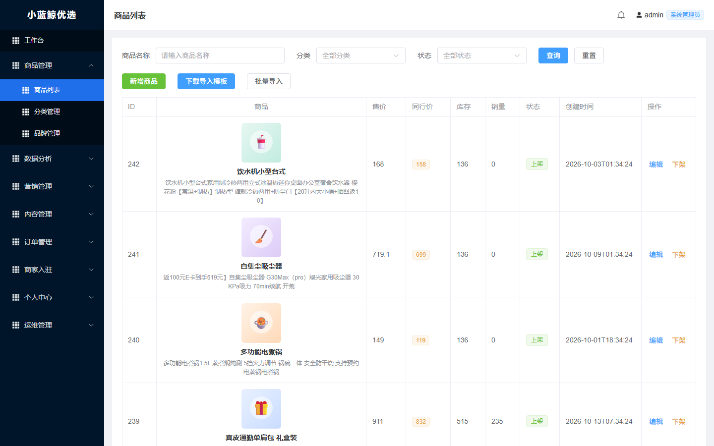
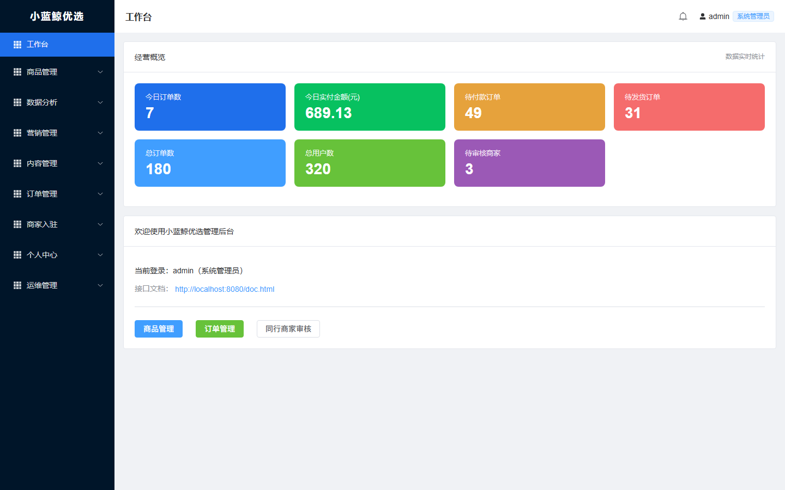
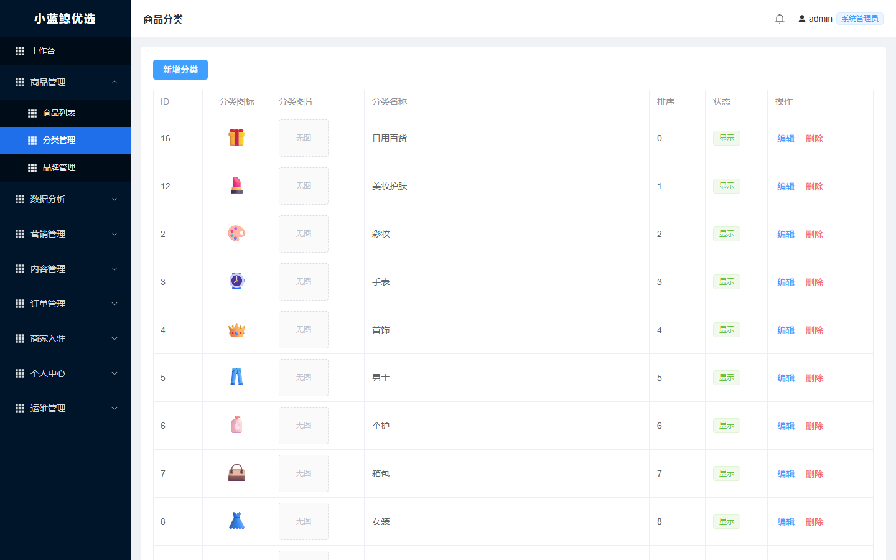
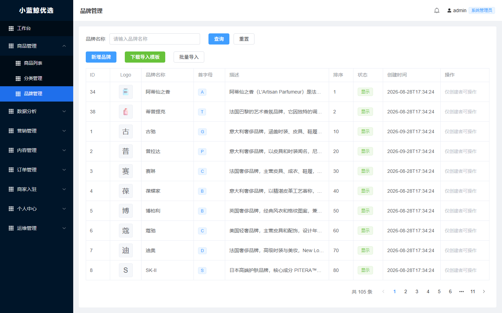
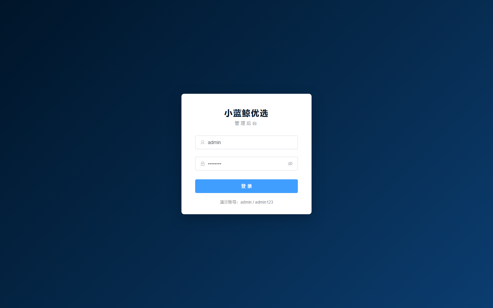
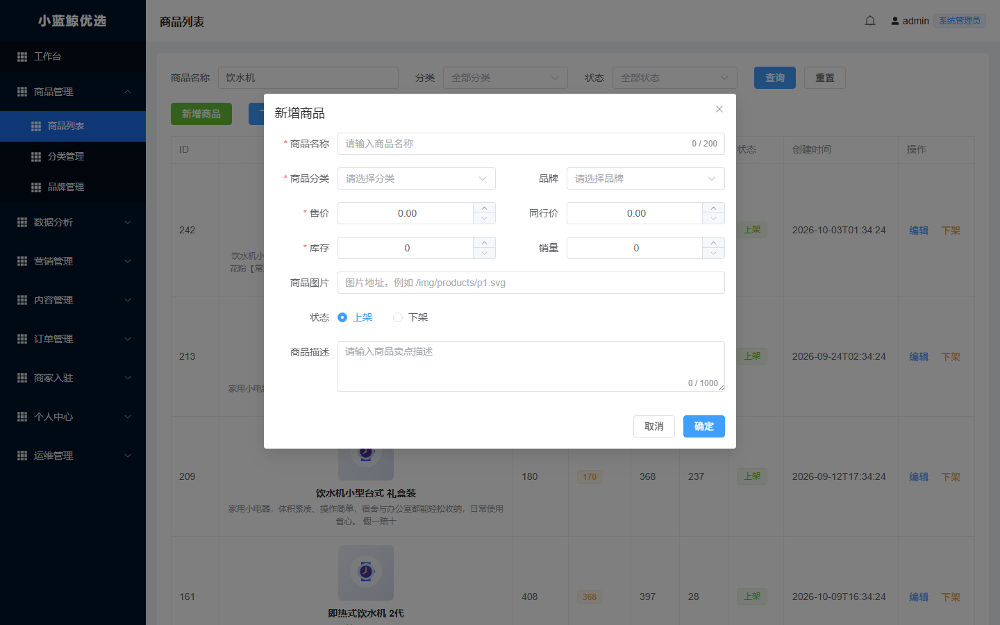

# 小蓝鲸优选 · 管理后台（复刻版）

依据 `原始网页/` 中的页面截图与构建产物，复刻「小蓝鲸优选 · 管理后台」的商品管理模块，
并配套完成 Java 后端与 MySQL 数据库的开发、建库与部署。

- 交付范围：**商品列表**、**分类管理**、**品牌管理**（登录鉴权作为访问前提一并交付；工作台及其他模块不在本次范围）
- 界面复刻依据：原始站点使用 Vue 3 + Element Plus，侧边栏 `#001529`、选中项 `#1f6feb`、
  子菜单 `#000c17`、页面底色 `#f0f2f5`、头部 60px、主区域 padding 16px 等样式均按原始 CSS 还原
- 演示地址：**http://localhost:8080**（本机浏览器直接打开；同一局域网设备可用 `http://<本机IP>:8080`）
- 演示账号：**admin / admin123**；接口文档：**http://localhost:8080/doc.html**

> 局域网访问需放行 8080 端口（管理员 PowerShell 执行一次）：
> `New-NetFirewallRule -DisplayName "Xlj Mall 8080" -Direction Inbound -Protocol TCP -LocalPort 8080 -Action Allow`
> 服务以 javaw + WMI 方式启动，关闭终端窗口不会停止；开机后执行 `scripts\start.ps1` 即可恢复。



## 一、技术栈

| 层 | 选型 |
| --- | --- |
| 前端 | Vue 3.5、Vue Router 4、Element Plus 2.9、Axios、Vite 6 |
| 后端 | Java 21、Spring Boot 3.3.5、Spring MVC、Spring Data JPA、Hibernate 6、Bean Validation |
| 数据库 | MySQL 9.7（本地 3306 实例） |
| 接口文档 | springdoc-openapi（`/doc.html` 重定向到 Swagger UI） |
| 构建 | Maven 3.9（后端）、npm + Vite（前端） |

## 二、目录结构

```
商品管理/
├─ pom.xml                   根聚合 POM（IDEA 直接以 Maven 项目导入本目录即可）
├─ .run/                     IDEA 共享运行配置（一键启动）
│  ├─ Xlj Mall Admin.run.xml              Application 方式（推荐）
│  └─ Xlj Mall Admin (Maven exec).run.xml Maven exec:exec 方式
├─ db/                       数据库脚本
│  ├─ 00-bootstrap.sql       建库 + 创建项目用户 + 授权（root 执行一次）
│  ├─ 01-schema.sql          表结构（项目用户执行）
│  └─ 02-seed.sql            演示数据（由 tools/gen-seed.mjs 生成）
├─ backend/                  Spring Boot 后端
│  ├─ src/main/java/com/xlj/mall/
│  │  ├─ controller/         REST 接口（认证、工作台、商品、分类、品牌、文档跳转）
│  │  ├─ service/            业务逻辑（分页查询、增删改、CSV 导入导出、统计）
│  │  ├─ repository/         Spring Data JPA 仓储
│  │  ├─ entity/             实体（admin_user、product、category、brand 等 7 张表）
│  │  ├─ dto/                请求/响应模型
│  │  ├─ security/           PBKDF2 口令摘要、HMAC 令牌、登录拦截器
│  │  ├─ config/             跨域、拦截器、SPA 回退（含 IDEA 运行时的前端目录回退）
│  │  └─ common/             统一响应、分页、异常处理
│  └─ src/main/resources/application.yml
├─ frontend/                 Vue 3 前端
│  ├─ src/layout/AdminLayout.vue    侧边栏 + 顶栏布局（复刻样式）
│  ├─ src/views/                    工作台、商品列表、分类管理、品牌管理、登录
│  ├─ src/api/                      axios 封装与接口定义
│  ├─ src/store/admin.js            登录态
│  └─ public/img/products/          商品占位图（SVG）
├─ tools/
│  ├─ gen-seed.mjs           生成演示数据 SQL
│  ├─ gen-images.mjs         生成商品占位图
│  ├─ api-test.ps1           接口冒烟测试
│  └─ ui-test.mjs / ui-test2.mjs   基于 Edge 无头浏览器的页面/交互验证与截图
└─ scripts/
   ├─ init-db.ps1            初始化数据库（建库、建表、灌入演示数据）
   ├─ build.ps1              构建前端 + 后端
   ├─ start.ps1              启动服务（jar，进程脱离终端）
   └─ stop.ps1               停止服务
```

## 三、数据库设计与部署

本地 MySQL 服务：`127.0.0.1:3306`，root 密码 `123456`（仅用于初始化，业务不使用 root）。

已创建：

- 数据库：`xlj_mall`（utf8mb4 / utf8mb4_0900_ai_ci）
- 项目用户：`xlj_mall` / `XljMall_2026`（`localhost`、`127.0.0.1` 两条记录）
- 授权范围：仅 `xlj_mall.*` 的 `SELECT/INSERT/UPDATE/DELETE/CREATE/DROP/ALTER/INDEX/REFERENCES`

表结构（7 张）：

| 表 | 说明 |
| --- | --- |
| `admin_user` | 后台管理员，密码为 PBKDF2-HmacSHA256 摘要 |
| `category` | 商品分类：图标、图片、排序、显示状态 |
| `brand` | 品牌：Logo、首字母、描述、排序、创建人 |
| `product` | 商品：分类/品牌、售价、同行价、库存、销量、上下架 |
| `member` / `merchant` / `mall_order` | 会员、入驻商家、订单，用于工作台实时统计 |

初始化（在项目根目录执行）：

```powershell
powershell -ExecutionPolicy Bypass -File scripts\init-db.ps1
```

脚本会依次用 root 执行 `db/00-bootstrap.sql`，再用项目用户执行 `db/01-schema.sql`、`db/02-seed.sql`，
可重复执行（种子脚本会先清空演示表再写入）。

演示数据规模：**16 个分类、105 个品牌、242 个商品、320 个会员、8 家商家、180 笔订单**。

## 四、构建与运行

前置条件：JDK 21、Node.js 18+、MySQL 已启动。Maven 可使用系统 `mvn`，
或使用项目内已下载的 `.tools/apache-maven-3.9.9`（脚本会自动识别）。

```powershell
# 1. 初始化数据库（首次）
powershell -ExecutionPolicy Bypass -File scripts\init-db.ps1

# 2. 构建前端 + 后端（前端产物会打进 jar 的 classpath:/static）
powershell -ExecutionPolicy Bypass -File scripts\build.ps1

# 3. 启动
powershell -ExecutionPolicy Bypass -File scripts\start.ps1
# 打开 http://localhost:8080 ，使用 admin / admin123 登录
```

停止服务：

```powershell
powershell -ExecutionPolicy Bypass -File scripts\stop.ps1
```

前端开发模式（热更新、`/admin` 代理到 8080）：

```powershell
cd frontend
npm install
npm run dev        # http://localhost:5173
```

## 五、在 IntelliJ IDEA 中一键运行

> 之前的报错 `POM file "pom.xml" specified the -f/--file command-line argument does not exist`
> 是因为项目根目录没有 `pom.xml`，IDEA 以根目录执行 Maven 时找不到 POM。
> 现在根目录已补上聚合 POM，IDEA 可以把整个项目作为 Maven 工程导入。

1. `File → Open` 选择项目根目录 **`商品管理`**（含 `pom.xml` 的这层），等待 Maven 自动同步；
2. 在右上角运行配置下拉框中选择 **`Xlj Mall Admin`**（即 `.run/Xlj Mall Admin.run.xml`），
   点击绿色三角（`Shift+F10`）即可启动；
3. 浏览器打开 <http://localhost:8080>，用 `admin / admin123` 登录。

`Xlj Mall Admin` 配置等价于：主类 `com.xlj.mall.MallAdminApplication`、工作目录 `backend/`、
JVM 参数 `-Dfile.encoding=UTF-8`。也可以直接右键 `MallAdminApplication` → `Run`。

**关于前端页面**：IDEA 直接运行 Application 时不会执行打包，后端会自动从
`frontend/dist`（相对 `backend` 的上一级）读取前端产物；因此首次运行前请确认已执行过
`cd frontend && npm install && npm run build`（本项目里 `dist` 已构建好）。
前端改动后重新 `npm run build`，刷新浏览器即可，无需重启后端。

**如果坚持用 Maven 方式运行**：请使用项目自带的 Maven 配置
**`Xlj Mall Admin (Maven exec)`**，等价命令：

```powershell
cd backend
mvn -Prun-app exec:exec
```

> 不建议使用 `mvn spring-boot:run`：当项目路径或 Maven 仓库路径包含中文时，
> spring-boot-maven-plugin 会把超长 classpath 写入 `@argfile`，而 JDK 启动器按本地编码读取该文件，
> 导致中文路径错乱并抛出 `ClassNotFoundException`。`run-app` profile 改用 `exec:exec`
> 直接把 classpath 作为进程参数传递，可稳定运行。

## 六、接口一览

统一响应：`{ code: 0, message: "ok", data: ... }`；鉴权头 `Authorization: Bearer <token>`。

| 方法 | 路径 | 说明 |
| --- | --- | --- |
| POST | `/admin/auth/login` | 账号密码登录，返回令牌 |
| GET | `/admin/auth/me` | 当前登录管理员 |
| POST | `/admin/auth/logout` | 退出登录 |
| GET | `/admin/dashboard/stats` | 工作台经营概览（今日订单/实付、待付款、待发货、总订单、总用户、待审核商家） |
| GET | `/admin/products` | 商品分页（`name`、`categoryId`、`status`、`page`、`size`） |
| POST / PUT | `/admin/products`、`/admin/products/{id}` | 新增 / 编辑商品 |
| PATCH | `/admin/products/{id}/status` | 上架 / 下架 |
| DELETE | `/admin/products/{id}` | 删除商品 |
| GET / POST | `/admin/products/template`、`/admin/products/import` | 下载导入模板 / CSV 批量导入 |
| GET | `/admin/categories`、`/admin/categories/all` | 分类分页 / 全量下拉 |
| POST / PUT / PATCH / DELETE | `/admin/categories...` | 分类增删改与显示隐藏 |
| GET | `/admin/brands`、`/admin/brands/all` | 品牌分页 / 全量下拉 |
| POST / PUT / PATCH / DELETE | `/admin/brands...` | 品牌增删改与显示隐藏（编辑/删除仅创建者可操作） |
| GET / POST | `/admin/brands/template`、`/admin/brands/import` | 品牌模板 / 批量导入 |

接口文档：启动后访问 <http://localhost:8080/doc.html>（自动跳转 Swagger UI，右上角 Authorize 填入登录返回的 token 即可调试受保护接口）。

## 七、已实现的功能细节

- **工作台**（代码中保留的附带页面，不在本次文档交付范围）：7 项经营指标来自真实 SQL 统计（`mall_order`、`member`、`merchant` 表），
  另含欢迎卡片、接口文档入口与快捷按钮。
- **商品列表**：按名称 / 分类 / 状态筛选，分页；新增、编辑、上架/下架；
  同行价以浅黄标签展示；CSV 模板下载与批量导入（逐行校验，返回失败行原因）。
- **分类管理**：图标（emoji）、图片、排序、显示状态；删除前校验分类下是否有商品。
- **品牌管理**：Logo（图片或 emoji，无 Logo 时展示名称首字）、首字母标签、描述省略、
  排序、状态；**仅创建者可编辑/删除**（列表对非创建者显示「仅创建者可操作」），与原始页面一致；
  支持模板下载与批量导入。
- **认证**：PBKDF2-HmacSHA256 存储口令；HMAC-SHA256 无状态令牌（8 小时有效），
  拦截器校验、401 自动跳转登录；前端路由守卫。

## 八、验证记录

- 接口冒烟：登录、工作台统计、三类分页、模板下载、CSV 导入、分类删除保护、品牌/商品增删改、401 拦截（`tools/api-test.ps1`）
- 页面交互：登录、搜索、分页、商品编辑保存、分类新增、品牌新增与删除（`tools/ui-test.mjs`、`tools/ui-test2.mjs`）
- 截图对照：`tools/screenshots/` 下为 1440×900 实际渲染截图，与 `原始网页/` 四张原图逐项比对
- IDEA 运行方式验证：删除 `target/classes/static` 后以 Application 方式（工作目录 `backend/`）启动，
  根路径 `/`、`/login` 与深层路由 `/products`、`/brands` 均返回 200 且命中 `frontend/dist` 中的 Vite 产物，
  浏览器控制台无报错、无失败请求
- 根目录 `mvn validate` / `mvn package` 通过；`mvn -Prun-app exec:exec` 启动成功

### 常见问题

| 现象 | 原因与处理 |
| --- | --- |
| 启动时报 `POM file "pom.xml" ... does not exist` | 项目根目录缺 POM；已补根聚合 `pom.xml`，用根目录重新导入/同步 Maven 即可 |
| `mvn spring-boot:run` 报 `ClassNotFoundException` | 中文路径下 spring-boot 插件写 `@argfile` 的编码问题；改用 `mvn -Prun-app exec:exec` |
| 浏览器直接显示 `{"code":500,...}` | 旧版本访问根路径 `/` 时的缺陷；现已由 `IndexController` 转发到 `index.html`，重启应用即可 |
| 页面白屏 / 静态资源 404 | 确认 `frontend/dist` 已构建（`cd frontend && npm run build`），刷新浏览器（`Ctrl+F5`） |

### 页面截图

| 工作台 | 商品列表 |
| --- | --- |
|  |  |

| 分类管理 | 品牌管理 |
| --- | --- |
|  |  |

| 登录页 | 新增商品弹窗 |
| --- | --- |
|  |  |
